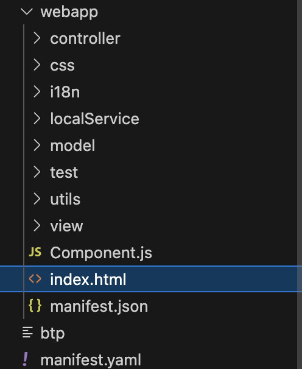
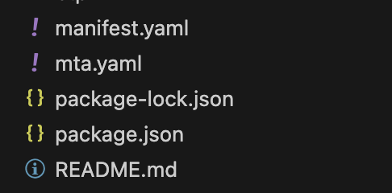
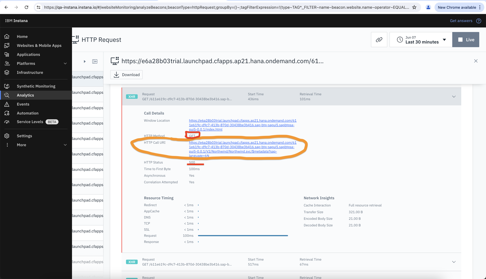

# Supercharge your SAP Business Technology Platform Cloud Foundry Apps with IBM Instana
- By [Ankit Guria](https://w3.ibm.com/#/people/003Z1Y744) Technology Engineer, IBM Ecosystem Engineering, Blue Partners Lab and 
-    [Joice Joy](https://w3.ibm.com/#/people/003YOA744) Engineer @ Team Enterprise Instana

Provide additional monitoring and performance visibility to SAP Business Technology Platform (SAP BTP) Cloud Foundry applications by integrating them with IBM® Instana. Whether you're working with SAP Ui5/Fiori, Node.js, or Java Spring Boot applications, this guide provides you with interactive steps to seamlessly install the Instana agent and start monitoring your apps in real time.

## Step-by-Step Guide to Integrate Instana Agent with SAP BTP Cloud Foundry

## Pre-requisites:
You need to get a SaaS license offering of IBM Instana for SAP Business Technology Platform. Learn how [here](https://www.ibm.com/products/instana)

### Plug & Play for SAP Ui5/Fiori Applications

1. **Insert the Instana Script**:
    - Open the `index.html` of your SAP Ui5 application. It will be inside the webapp directory.


    
- Add the following script to enable Instana monitoring:
    ```html
    <script>
      (function(s,t,a,n){s[t]||(s[t]=a,n=s[a]=function(){n.q.push(arguments)},
      n.q=[],n.v=2,n.l=1*new Date)})(window,"InstanaEumObject","ineum");
      ineum('reportingUrl', ''); // Add your reporting URL here
      ineum('key', ''); // Add your Instana key here
      ineum('trackSessions');
    </script>
    <script defer crossorigin="anonymous" src="https://eum.instana.io/1.6.6/eum.min.js" integrity=""></script>
    ```

2. **You're All Set**:
    - Deploy your application, and the Instana agent will begin monitoring immediately.

### Plug & Play for Node.js Applications

1. **Install the Instana Package**:
    - If using npm, run:
    ```bash
    npm install --save @instana/serverless-collector
    ```
    - If using yarn, run:
    ```bash
    yarn add @instana/serverless-collector
    ```

2. **Configure the Manifest File**:
    - Update your `manifest.yaml` with the necessary Instana configurations. The manifest location will be at the root directory of the application:
    
    
    ```yaml
    applications:
    - name: node-demo-api
      host: node-demo-api
      domain: cfapps.ap21.hana.ondemand.com
      buildpacks:
        - nodejs_buildpack # optional
      env:
        NODE_OPTIONS: '--require ./node_modules/@instana/serverless-collector'
        INSTANA_AGENT_KEY: '' # Add your agent key
        INSTANA_ENDPOINT_URL: '' # Add the endpoint URL
        INSTANA_LOG_LEVEL: '' # Set the log level
    ```

### Plug & Play for Java Spring Boot Applications

1. **Download the Instana Collector**:
    - Obtain the latest standalone JVM collector from the Instana repository:
    [Instana Collector Download](https://artifact-public.instana.io/artifactory/rel-generic-instana-virtual/com/instana/standalone-collector-jvm/[RELEASE]/standalone-collector-jvm-[RELEASE].jar)

2. **Update the Manifest File**:
    - Add the following configurations to your `manifest.yml`. The manifest location will be at the root directory of the application:
    
     
:
    ```yaml
    applications:
    - name: rest-demo-app
      path: ./target/rest-0.0.1-SNAPSHOT.jar
      host: rest-demo-app
      domain: cfapps.ap21.hana.ondemand.com
      env:
        JBP_CONFIG_JAVA_OPTS: 'java_opts: "-javaagent:BOOT-INF/lib/standalone-collector-jvm-[version].jar"'
        INSTANA_AGENT_KEY: '' # Add your agent key
        INSTANA_ENDPOINT_URL: '' # Add the endpoint URL
        INSTANA_LOG_LEVEL: 'TRACE' # Set the log level
    ```

### Final Steps

 **Deploy Your Applications**:
    - Push your applications to SAP BTP Cloud Foundry with the Instana agent configurations enabled. For SAP UI5/Fiori apps,i.e., multi target          applications: 
 ```bash
    mbt build
 ```
and then Deploy mta archives.
- For other cloud native applications, do a 
    ```bash
    cf push
    ```
 **Monitor in Real-Time**:
    - Use the Instana dashboard to monitor your applications in real-time, providing you with insights and actionable data to optimize performance and troubleshoot issues.
For reference, we are leveraging the REST calls failures here:
 


By following these interactive steps, you can effortlessly integrate Instana with your SAP Cloud Foundry applications, providing additional monitoring and performance visibility . 

Happy coding and monitoring!
